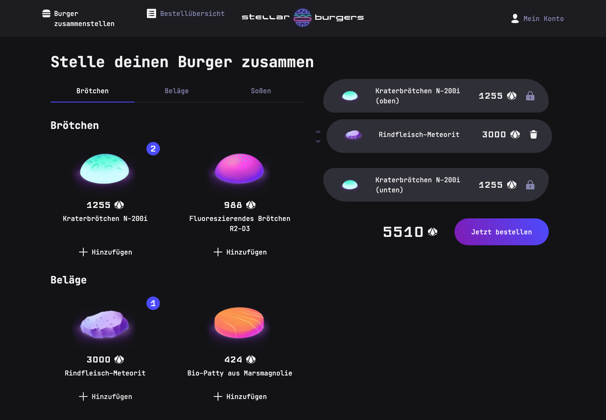
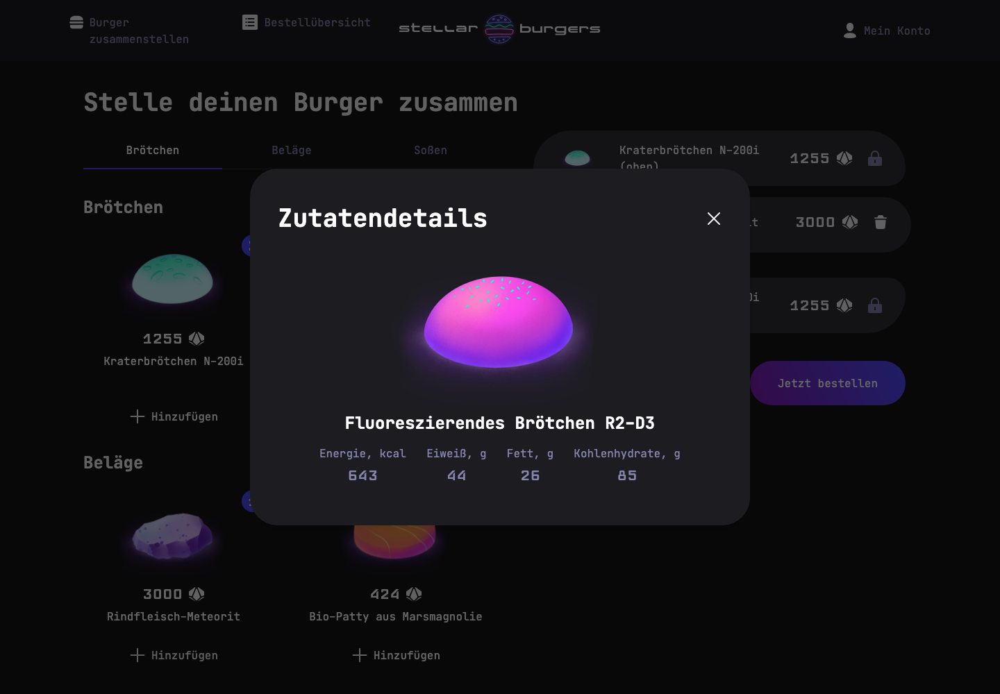

# Stellar Burgers · Burger-Konfigurator

Eine deutschsprachige React-Anwendung zum Zusammenstellen und Bestellen eines Weltraum-Burgers. Das Lern- und Portfolioprojekt zeigt die Arbeit mit TypeScript, Redux Toolkit, einer REST-API und automatisierten Tests.

**React · TypeScript · Redux Toolkit · REST API · Jest · Playwright**



*Zutaten auswählen, den Burger zusammenstellen und den Gesamtpreis direkt sehen.*

## Einblick in die Anwendung

Ein Klick auf eine Zutat öffnet ihre Detailansicht mit Bild und Nährwerten. Die Auswahl im Konfigurator bleibt dabei erhalten.



Die Screenshots zeigen die lokal gestartete Anwendung mit dem Zutatenkatalog der API. Eine öffentlich gehostete Demo ist derzeit nicht eingerichtet. Die Anleitung unten erklärt den lokalen Start.

## Technische Schwerpunkte

- **Zustandsverwaltung:** Redux-Slices für Zutaten, Burger-Konfiguration, Authentifizierung und Bestellungen
- **API-Anbindung:** asynchrone Datenabfragen und Erneuerung abgelaufener Zugriffstoken
- **Navigation:** geschützte Profilseiten und Detailansichten als Dialoge
- **Tests:** Unit-Tests für Redux-Logik und Browser-Tests mit reproduzierbaren HAR-Antworten
- **Lokalisierung:** deutsche Oberfläche, übersetzte Katalognamen und landesspezifische Datumsdarstellung

## Funktionen

- Zutaten nach Brötchen, Belägen und Soßen durchsuchen und Nährwerte im Dialog ansehen
- Einen Burger zusammenstellen, Zutaten entfernen und ihre Reihenfolge ändern
- Registrierung, Anmeldung, Profilbearbeitung und Passwort-Zurücksetzen
- Bestellungen aufgeben sowie öffentliche und persönliche Bestellübersichten anzeigen
- Deutsche Oberfläche, übersetzter Zutatenkatalog und Datumsformatierung mit `de-DE`

## Technologie und Aufbau

React 19, TypeScript, Redux Toolkit, React Router und Vite bilden die Anwendung. CSS Modules kapseln die Gestaltung; die UI-Komponenten stammen aus `@krgaa/react-developer-burger-ui-components`. Jest prüft die Redux-Logik, Playwright die wichtigsten Abläufe im Browser. Storybook enthält Komponentenbeispiele.

```text
src/components/       Anwendungs- und UI-Komponenten
src/pages/            Seiten und Formulare
src/services/         Redux-Store, Slices und Unit-Tests
src/utils/            API, Typen, Cookies und Katalogübersetzung
src/stories/          Storybook-Beispiele
tests/                Playwright-Tests, HAR-Archive und Testdaten
```

## Lokal starten

Voraussetzung: Node.js 22.12 oder neuer und npm.

```bash
npm ci
cp .env.example .env
npm run start
```

Die Anwendung läuft unter http://localhost:4000. `VITE_BURGER_API_URL` konfiguriert die Lern-API; ohne Einstellung wird `https://norma.ffapi.ru/api` verwendet. Für die normale Nutzung ist eine Verbindung zur API erforderlich. Es handelt sich um ein Lernprojekt ohne echte Zahlungsabwicklung.

```bash
npm run build       # Produktionsbuild nach dist/
npm run preview     # Produktionsbuild lokal ansehen
npm run storybook   # Komponenten unter http://localhost:6006
```

## Qualitätssicherung

```bash
npm test -- --runInBand
npx playwright install chromium
npm run e2e
npm run check
npx tsc -b
```

Playwright startet den Entwicklungsserver selbst; Port 4000 muss frei sein. Die API-Antworten für die getesteten Abläufe kommen ausschließlich aus versionierten HAR-Dateien über `page.routeFromHAR` mit `notFound: 'abort'`. Es werden keine Antworten über `page.route` erzeugt. Die HAR-Archive enthalten ausschließlich synthetische Testdaten.

Der Bestelltest setzt sowohl den `accessToken` als Cookie als auch den `refreshToken` in `localStorage`. Er prüft zusätzlich, dass der Zugriffstoken mit der Bestellung gesendet wird. Die Tests prüfen außerdem das Hinzufügen von Zutaten, Zutatendetails innerhalb des Dialogs, das Schließen von Dialogen und das Leeren des Burgers nach einer Bestellung.

## Projektkontext

Das Projekt basiert auf einer Lernvorlage für Stellar Burgers. Die deutsche Portfoliofassung ergänzt die Lokalisierung, eine nachvollziehbare Startanleitung und die Korrekturen aus dem Code-Review. Die Backend-API und die UI-Bibliothek sind externe Bestandteile. Vom Server gelieferte Zutaten werden beim Einlesen übersetzt; Bestelltitel entstehen aus den übersetzten Zutaten. Neu hinzukommende Katalognamen behalten bis zur Ergänzung der Übersetzung ihren Originalnamen.
